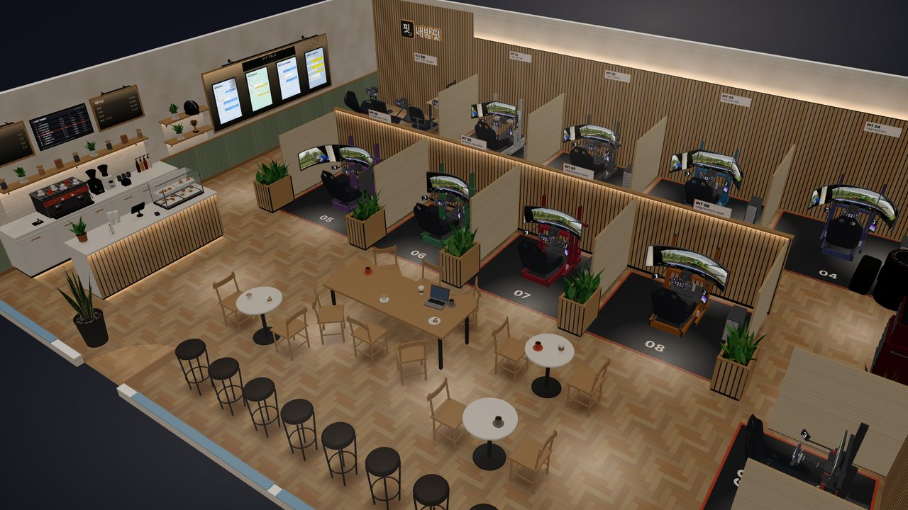

# Changelog

[한국어](CHANGELOG.md) · **English**

## 1.9.1 — 2026-11-07

- On a first visit, "Get started" no longer opens the how-to video over the app. The Room step's help button stands out instead ("New here? ○ sec video") and opens the same video (it goes back to the usual button once you open it or move on to Furniture)

## 1.9.0 — 2026-11-07

- A new Showroom: a bright wooden neighbourhood café with 10 rigs — four triples on the back wall (PIT 01–04), four ultrawides on a centre island (05–08), two singles by the window (09–10)
- The café: a coffee bar (espresso machine, grinders, tiled wall, menu boards), a pastry counter, a long table, round tables and a window bar; sit on the chairs and stools
- The rig types on show in a corner (folding, tube frame, desk clamp), a PC by every rig, the PIT TALK wall, a workshop corner (tool board, tyres, a promo TV), the Naebangfit sign
- A street outside the windows (pavement, wall, trees, street lamps, sky), cream limewash walls, sage panelling, a coffered ceiling
- The Showroom opens at night: dark outside, LED indirect lights, pools of light under the ceiling lights (day is one switch away); a Showroom tour
- Choose the screen distance in the Showroom too: "Same distance" (default: your own rig's distance, or 80 cm) or "Recommended per size", remembered apart from the Big Screen Hall
- Showroom chairs and stools start in the plain view (rigs keep the wide view)
- Big Screen Hall: the profile rigs are now 40×160 (the 40×40 seat rails stay), with a PC by every rig
- Rig tabs: from 11 on they read "11", not "Rig 11"
- "Same distance" goes up to 115 cm in the Big Screen Hall and 110 cm in the Showroom (any further and the stands reach the back wall)
- Phones: the PIT card no longer hides under the pill at the top (Showroom and Big Screen Hall), and the Night switch no longer gets cut off during the tour
- What's new: 1.9.0, with a picture of the new Showroom
- How-to video: the Showroom episode remade in the new Showroom (PC and phone, Korean and English)

## 1.8.2 — 2026-11-06

- Monitors: 39" 16:9 single and triple (flat or 3000R, 38.5" visible)
- 39" 21:9 ultrawide (single and triple): choose 800R or 1500R
- A curved monitor always shows its curvature, even when there is only one, so you can check it is yours
- Start screen: a What's new button under the intro film button (with a blue dot when there is something you haven't seen)
- What's new: older entries show their film too when opened
- Switching to a desk monitor arm moves the desk chair out of the spot the rig rolls into (it used to make the verdict "doesn't fit")
- Monitor tab › Mount: the "Monitor arm position" row no longer sits right against the buttons above it
- Setup gallery: example rooms tidied (2 examples; the big-window one is gone, the L-shaped room is now example 2)
- Big Screen Hall film in English (English page)
- Five how-to videos remade on the 1.8.0 screens: Getting started, Choosing a rig, Choosing monitors, See result, Looking around and the seat (PC and phone, Korean and English)

## 1.8.1 — 2026-11-06

- More anonymous usage stats (nothing on screen changes)
  - Big Screen Hall tour · night · screen distance · moving between pits · bar stool, Lite mode (by hand / switched on by itself when it stutters), high-quality light, PC under the desk, garage save, setup card text copy, iRacing settings save
  - When the app opens: the unit in use (cm · mm · in) and the link's campaign tags (utm_source · utm_medium · utm_campaign, letters and digits, 40 at most)
- What's new: a version with nothing new on screen (like this one) no longer hides the 1.8.0 dot and start-screen line from people who haven't seen it
- Privacy Policy: "campaign tags on the link (utm)" added to what is collected

## 1.8.0 — 2026-11-06

- Monitor tab: pick single or triple, then the screen shape (16:9 standard · 21:9 ultrawide · 32:9 super ultrawide), then the size, then the curve (flat · 1000R), one row each
  - 16:9 holds the usual sizes and "Large · floor stand" 42" · 48" · 55" · 65" (TV panels). The 55" single and triple can be 1000R (old "single 55" curve" setups open as this)
  - New ultrawide triples 34" (1800R) and 39" (800R), and the ultrawide 39" single (800R)
  - Which screens go on a floor stand only is decided by size: every large screen, and triples 2.2 m wide or more, or 10 kg or more a screen
  - A large screen shows a picture of its size next to a 175 cm person
  - The eye distance follows the monitor you pick (85 · 95 · 105 · 125 cm). Set it by hand and it stays, until you switch to or from a large screen. Up to 160 cm; no overhead screen
  - Verdict: says when the side screens reach past your eyes
- The rig step, tidied: fewer things to press at first sight
  - Rig tab: one rig card (name + Change; the types open from it), equipment, posture (your height + "Sit in the driver's seat ›"), More (button lights · frame colour · my rigs · duplicate/delete this rig)
  - With two or more rigs, one row of tabs on top: [Rig 1] [Rig 2] [+] (the hall: 01 to 06)
  - Monitor tab: Screen (single/triple · shape · size · curve; the sizes in one row, 27" 32" │ 42" 48" 55" 65") → Mount (rig-mounted · floor stand · desk arm, moved from the rig tab) → Fine-tune (side angle · stand leg span · top monitor, folded)
- Large stand (triples 42" and up): centre frame plus a T-foot under each side screen, casters, vertical VESA rails; the side feet are checked against the rig frame
- Floor stand (32" and below): 128 cm posts, 70 cm feet with the post a third of the way from the back (2/3 in front, 1/3 behind), corner gussets at the post, triple arms hinged at the posts (the 72 cm default leg span stays)
- Big Screen Hall (new): six triple booths, 32" · 42" · 48" · 55" · 55" 1000R · 65", each with a plate of what you actually see; ◀ ▶ goes from 32" up
  - Black slat partitions, polished concrete floor, terrazzo booth floors edged in steel, walnut walls, red LED, a ceiling spot over every rig, a dark backdrop around the view
  - Light: soft wall-washer scallops down the front wall, a coffer 38 cm up into the ceiling over the middle with hidden cove light, grazers over the slat walls behind the pits and a bias light behind each set of screens, the pit number painted on the floor (01 to 06) and LED round each booth, walnut slats behind the logo (all drawn light, so phones keep 60 fps)
  - Bar: a smoked bronze mirror with three dark walnut shelves (an LED under each), bottles of five kinds (whisky · wine · gin · sparkling · liqueur, made-up house labels) and glasses, whisky on the rocks, a glass of red and an ice bucket on the counter, a fluted walnut counter front
  - Front wall: a reception desk (booking tablet) under a live timing board (the order at the same moment as the drive video, changing as it plays, the video's car marked ON-SCREEN CAR), a lounge TV playing the drive video's middle screen in 16:9, three snake plants in fluted ceramic pots with pebbles, clear of the door's swing, a PIT EXIT light box over the door whose five start lights come on one by one as you walk up and go out
  - The cars and the circuit from the drive video: 1/12 models on the counter, 1/8 on the plinths by the team sets, an ON SCREEN tag on every case, a monitor at the counter end playing the drive (middle screen, 16:9), the diorama 1.25x with contour lines like an architect's model (darker than the ground, so the track stands out from afar) and a red dot running where the video's car is right now
  - Hardware tower: a card with each piece's name in the app ("Pick it in Naebangfit") and a sign on top, "The gear from the app"
  - Team race suits with the sponsors printed on and the sleeves clear of the body, caps with embroidered names, soft fabric gloves
  - Our logo built in 3D with a soft amber halo, two team race suits (made-up sponsors, calm navy and burgundy) with helmets, the GT3 and LMP from the drive video as models in lit cases, a diorama of the video's circuit (pits, grandstands, start line), a hardware tower (DD base · quick release · extension · pedals · stream deck · button box · handbrake · shifter · three wheels), a shadow-board tool wall (30-odd tools) with a tool chest and slicks, a bar corner (sit on the stools), a lounge
  - Screen distance: at the bottom of the driver's view, "Recommended per size" or "Same distance" (starting from your own rig's eye-to-screen distance at home, 80 cm without one, in 5 cm steps); with one distance the pit plates show that distance and what you see at it. On a phone, tap the pit card (PIT 0n)
  - Tour: "Tour" in the view bar glides the camera round the hall at head height (a tap or a key stops it, H hides the text)
  - Night: the ceiling lights off, only the LED coves, the wall light and the screens
  - Floor reflections: every pit's screens, the lounge TV and the timing board show softly in the polished floor (moving with the video), and a sheen on the floor in front of the low LED coves
  - A merch stand by reception (caps · tees · mugs · gloves · key rings, an NBF STORE light box on top) and a hanging PIT sign over every booth
  - Straight from the start screen and the example list, a button between it and the Showroom, a gallery picture
- Fewer buttons in the driver's seat: the row is ◀ · Stand up · ▶ and one menu (the drive video · wide view); while seated, the showroom pit card keeps just the pit and the compare picker
- Phones play the screens in every view like a computer (phones used to start in Lite mode, moving only from the driver's seat); if the view stutters badly it switches to Lite mode by itself, and Menu › Lite mode turns it on or off
- What's new (new): Menu › What's new shows what changed in each version, briefly (every version since 1.0.0; earlier ones folded). 1.8.0 comes with the showroom film on the Korean page (also in Menu › How to use). A blue dot on the menu when there is a new version, and one line on the start screen for people who used an earlier one (once)
- The creator's Naver Cafe post links are gone from the app (the triple setup series, dampening and lighting posts, the setup card's example post); the setup card's "Copy post text" is now "Copy as text"
- Showroom: PIT 05 is the ultrawide triple 39"; 45" · 49" · 57" move to PIT 06 · 07 · 08. Every seat is set 65 cm from the eyes so they compare fairly
- Fixed: with motion or traction loss on in your own room, a visit to the Showroom put a motion base under the seat you sat in, and it spread to every seat you moved to
- Monitor and TV backs: gaming monitor rear housing, TVs as a thin panel with the electronics box low on the back, curved screens with a rear shell
- Adding a rig or furniture in a big room was slow: the free-spot search now starts nearby, about 40× faster in a 13×10 m room (same spots as before)
- Signs, posters and partitions on a wall now hide with that wall when the view cuts it away, instead of floating
- Ceilings: walking, sitting and the driver's seat show a ceiling. Your room gets ceiling lights placed for its size and shape (1 up to 16 m², 2 up to 30 m², then one per ~15 m²; one in each arm of an L-shaped room); the Showroom has downlights. Your room's ceiling light is a slim edge-lit panel (1.6 cm)
- The PC can go under the desk: in the Furniture step, tap the PC and "Under the desk" (and "On the desk" to put it back)
- Fixed: walking in the Showroom or the hall, then walking in your own room, started you outside its walls, unable to move
- Walking: the Showroom's and the hall's tables, shelves, mannequins, cases, bar, diorama, tool chest and partitions now stop you (before, only walls and furniture you placed did)
- Furniture: bedside table (legs, two drawers), TV stand (legs, fluted doors)
- Lighting preview: bigger screens throw more light on your hands

## 1.7.5 — 2026-11-03

- Notices on the phone cover less of the screen
  - A notice is as wide as its text (before, it was held to half the screen, so even a short one broke after every word)
  - Slightly smaller text, and Korean never breaks inside a word
- Long notices and hints break where it reads naturally
  - If one doesn't fit on a line, each " · " part and each sentence goes on its own line
- A shorter notice when you press furniture in the Rig step
  - First time: "The Rig step moves just the rig / The Furniture step moves both", after that: "Move furniture in the Furniture step"

## 1.7.4 — 2026-11-03

- A more exact traction loss check
  - The swing is worked out in 2° slices along the real path (before, each part was wrapped loosely, which reached 1–2 cm too far near the pivot)
  - It says what hits what: "the seat hits the stand monitors", "the rig's side hits the stand legs"
  - The spots that touch are marked red on the floor
  - Contacts that are already there at rest go to the normal check; traction loss only reports new ones from the swing
- Floor stand + motion: the stand legs hitting the motion base's actuator feet is now caught (it was missed before)
  - "Widen stand legs" button on the verdict card: widens the leg span until they clear
- Phone: stop the bottom panel at any height
  - The handle follows your finger and the panel stays where you let go
  - A quick flick goes to the next stop (20 · 36 · 60 · 80 %); tapping the handle steps through heights as before
  - The Rig/Monitor tabs stick to the top only when the panel is 60 % or taller
- Pressing furniture in the Rig step shows a notice with a "Go to Furniture" button
  - The first time it also says why (the Rig step moves only the rig, precisely; the Furniture step moves the rig too)
  - The button opens the Furniture step with that piece selected

## 1.7.3 — 2026-11-03

- Choose the motion base (Rig › Equipment › Motion)
  - 4 actuators: the same height as before (14 cm). Tilts front to back and side to side, and bumps on kerbs
  - 6-axis platform: a hex base on the floor and six actuators (38 cm high, base about 1.2 × 1.4 m). Tilt and heave plus surge and sway
  - The actuators now stretch and shorten as the rig moves
- Traction loss (±6° · ±10° · ±15°)
  - In corners the rear of the rig steps out. 4 actuators: a front pivot and a curved rear rail; 6-axis: about the platform's center
  - Fit check: the whole swing is checked against walls, furniture (with heights), the monitor stand and doors
  - The swept area is drawn on the floor (red where it hits)
- Driver's view: your eye rides the seat through yaw, heave, surge and sway too, and your head turns with the seat
- Fixes
  - Showroom: the screens froze when the 3D drive played instead of the video (video not loading, or the standalone file) (since 1.7.2)
  - The screens could freeze on a selected rig when the drive video was drawn the plain way
  - An error when you typed a length on PC and then clicked elsewhere
  - The first-visit flag in the anonymous usage stats was always recorded as "no"

## 1.7.2 — 2026-11-03

- The drive video on the monitors is sharp in the normal view too
  - Before: the view from the eye was first drawn into a 360° picture (1024 px a side, 2048 px with high quality) and then put on the monitors, so in the normal view, where a monitor fills much of the screen, it was stretched 1.5–3x and looked blurry
  - Now: every point of a monitor takes its colour straight from the drive video, in the direction it is seen from the eye, at the video's own resolution
  - Layout and angles are the same as before (triple, ultrawide, single, wide view, Showroom, your own video)
  - Lighter: no 360° picture is drawn every frame

## 1.7.1 — 2026-11-03

- Motion base in the driver's view: feels like sitting on a real motion rig
  - The rig now tilts in the driver's view too, the same as in the room view (braking and throttle forward and back, corners side to side)
  - The seat carries your eye (under braking your head moves toward the screens)
  - Your head stays closer to level than the seat: it takes about a third of the tilt, a little later
  - Rig-mounted monitors and the wheel move with you; monitors on a floor stand or a desk stay put (before, only the view tilted, so the wheel and monitors swayed in front of you)
- The person model in the light test tilts with the seat too

## 1.7.0 — 2026-11-03

- Setup gallery: post with just a nickname, no sign-in
  - Nickname field when posting (2–12 characters, remembered in this browser), shown on cards and in the detail view
  - Posting without signing in runs a Cloudflare Turnstile bot check (usually invisible), then creates an anonymous account for this browser
  - A setup posted without signing in can only be deleted from the browser that posted it; Google sign-in still works (delete from any device)
  - My Library and reporting still need a Google account
- Server: nickname required for anonymous accounts, 30 anonymous posts per hour in total, anonymous accounts with no posts deleted after 30 days
- Privacy policy: nickname, anonymous accounts and Cloudflare (bot check) added

## 1.6.2 — 2026-11-02

- Phones: windows taller than the screen now scroll
  - Setup gallery and the guide video list scroll inside the window
  - Menu › Settings opened: the menu ends on screen and scrolls (Reset all and the open-source notice are reachable)
- Rig step Rig/Monitor tabs: at the phone's normal panel height they scroll away with the list instead of covering it; pinned at the top when the panel is pulled all the way up

## 1.6.1 — 2026-11-02

- Inches by default only in the US: English page + US English browser + a US time zone (Hawaii, Alaska and US territories included)
  - Browsers set to US English outside the US start in cm
  - A unit chosen in Menu › Settings still wins

## 1.6.0 — 2026-11-02

- New address: https://naebangfit.com (English: https://naebangfit.com/en/)
  - The old address (rlacksgur06.github.io/naebangfit) forwards to the new one; old share links still open
  - New share links, setup card QR codes and link previews use the new address
- Rooms and settings saved in the browser belong to each address, so the new address starts fresh (setups saved to an account are unchanged)

## 1.5.3 — 2026-11-02

- English videos on the English page: 22 how-to videos (PC 12, phone 10), Getting started, and the intro video
  - Recorded from the English app, with English captions and titles
  - The video list shows the English lengths
- The Korean page is unchanged; the start screen loop is shared by both

## 1.5.2 — 2026-11-02

- iPhone Safari (iOS 26)
  - The app now fits the visible area, so the floating bottom bar no longer covers the panel
  - No more blur at the top: a strip in the page colour under the clock and battery
  - Tab and history icons: PNG icons first
- Tablets: the how-to video follows the layout (PC screens in landscape → PC video)
- Integrity checks on outside code (3D engine, sign-in library, QR): a changed CDN file is not run
- Values screen for checking a device: Menu › Open source & credits, tap the version five times

## 1.5.1 — 2026-11-02

- New intro video (new cut, 42 s)
- New start screen loop (7 s, 4.3 MB → 1.3 MB)
- Site icon: browser tab, add to home screen, next to link previews
- New link preview image: example room 1, laid out in the centre so Naver Cafe and KakaoTalk no longer crop it
- Copyright line now includes the GitHub account
- Docs: README and changelog split into Korean and English

## 1.5.0 — 2026-11-01

- Inch units: Menu › Settings › Units (cm · mm · in)
  - Rooms in feet and inches (e.g. 11′ 6″), furniture and gaps in inches, area in ft², cables in lengths you can buy (3 · 6 · 10 · 15 ft…)
  - Rig Garage profiles, game FOV values and part specs stay in mm
  - The English version opens in inches in US browsers
- Cleaner start screen: one link, "Browse other rooms ›" ("Start over" too when continuing); the intro video moves to ▶ under the sound button
- Setup gallery: "Naebangfit examples" on top, with the Showroom and 3 example rooms (open in view mode; your own room stays as it is)
- One help button: the separate "How this step works" is gone; the written guide is under "Read instead" in the video window
- Toolbar ···: "How to" (the view tools and menu video)
- Menu: "Load from share code" moves into the Share window; "Language" moves into Settings

## 1.4.0 — 2026-11-01

- How-to videos: "▶ How to" next to each step's title (landscape on PC, portrait on phones, 1× · 1.5× · 2×, music ducks while playing)
- "Getting started" video plays once on the first start
- Menu › How to use: the intro video and every step's video
- Start screen: silent background loop (a still frame with data saver, slow connections or reduced motion), intro video link
- Rig Garage video ends with "Next: Garage handles ›"

## 1.3.0 — 2026-11-01

- Setup gallery: browse rooms and rigs shared by others and open them as they are (newest, most opened)
  - After signing in: post your setup (title, one-line note, room picture) and delete your own posts
  - Names and emails are never shown; posts with enough reports are hidden automatically
  - Also from "Post to gallery" in the Result step and the start screen link
- Privacy Policy: setup gallery section (Korean and English)

## 1.2.0 — 2026-11-01

- Short share links: `…/naebangfit/?s=AbCd2345`. Simpler QR on the setup card. Falls back to a long link with the whole setup when the server can't be reached
- Phone sharing: the Share button opens the phone's share sheet (KakaoTalk, Messages)
- Link previews: pasting a link in KakaoTalk, messengers or social media shows a card with a picture, title and description
- English version (`/en/`): browsers not set to Korean open it first; switch any time from the menu
- Privacy Policy: share link section, English version (`privacy-en.html`)

## 1.1.1 — 2026-11-01

- Privacy Policy link in the sign-in window uses the app colour
- Scheduled job wakes the sign-in server (Supabase free plan) twice a day so it doesn't pause

## 1.1.0 — 2026-11-01

- Sign-in and My Library: save rooms and rigs as setups with a Google account (up to 50) and open them again on PC or phone
  - Save under a new name, overwrite, delete, delete account (account and setups removed at once)
  - Everything still works without signing in
- Privacy Policy ([privacy-en.html](privacy-en.html)), linked at the bottom of the menu

## 1.0.1 — 2026-11-01

- Anonymous usage stats: app version, browser language and time zone; no IP location
  - What is sent is listed on the start screen and in Menu › Open source & credits; turn it off in Menu › Settings

## 1.0.0 — 2026-11-01

First public version.

- Room: width, depth, ceiling height, doors and windows (hinged, sliding, opening side), example rooms, draw your own layout on PC
- Furniture: by category, drag to move and rotate, snaps to walls and other furniture
- Rigs: aluminium profile, foldable and fixed seat rigs, desk clamp, compare several, design your own on PC
- Monitors: single, ultrawide, triple (curved too), rig-mounted, floor stand or desk monitor arm
- Verdict: does it fit, can the door open, room to get in and out, screen distance
- Driver's seat: seated view, 200° wide view, day and night driving footage with engine sound, FOV values per game
- Tools: cable lengths, lighting preview (light bar), Showroom (10 monitor setups), setup card (QR), share links
- Display: phone support, light and dark, cm and mm units
