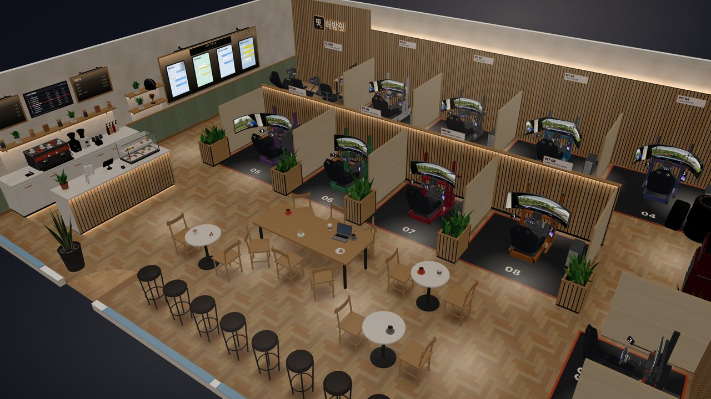

# 변경 기록

**한국어** · [English](CHANGELOG.en.md)

## 2.0.1 — 2026-11-14

- 휴대폰: 체험 카페와 대형 쇼룸을 오갈 때 화면이 하얘지거나 처음 화면으로 돌아가던 것 고침. 카페나 쇼룸에서 나갈 때 그곳의 그림(포스터 · 간판 · 벽과 바닥 · 화면 그림)이 그래픽 메모리에 남아 쌓이고 있었음 (카페에서 약 170MB, 쇼룸으로 넘어가면 그 위에 160MB, 돌아오면 200MB 더). 이제 방을 불러오거나 카페 · 쇼룸 · 예시 방에 들어가고 나올 때 화면에 없는 그림을 비움(`texSweep`). PC 도 같음
- 주행 영상이 비치던 모니터의 화면 그림이 리그를 다시 만들 때마다 한 장씩 남던 것 고침
- 휴대폰 · 태블릿: 카페 · 쇼룸의 그린 그림과 모니터의 정지 화면을 절반 크기로 (메모리 4분의 1). 휴대폰 크기에서 카페의 그림이 약 170MB → 53MB

## 2.0.0 — 2026-11-14

**시트 포지션**
- 리그 탭에 "시트 포지션": 자세(GT · 포뮬러)와 내 키를 고르면 시트 높이·기울기, 페달 판, 휠 높이·기울기·연장봉, 모니터 거리·높이를 몸에 맞춰 정함 (프로파일 리그). "기본"을 고르면 2.0 전의 자리 그대로(몸에 맞추지 않음). 2.0 전에 만든 리그는 "기존"으로 남고, 고르기 전까지 그대로
- "옆에서 자세히 보기"(시트 포지션 모드): 조립할 때 볼 높이·거리·각도를 줄자 그림으로. 숫자는 그 선 위에, 거리 기준은 시트 앞 끝. 차종 4가지(GT · 포뮬러 · 일반·랠리 · 프로토타입), 몸 치수 5가지(그림 안내), 눈에서 화면까지 거리, 사진 한 장으로 지금 자세의 관절 각도 확인
- 자세 계산: 조건을 정해진 순서로 푸는 방식(몸통 → 다리 → 팔 → 모니터). 키 1cm 에 결과가 튀지 않음. 다리는 림뿐 아니라 휠 베이스 밑으로도 지나가게 풂(모자라면 림을 덜 기울이고, 그다음 범위 안에서 덜 눕힘). 차종별 각도 범위는 참고값이고 앱에 "참고용 자세"라고 적음
- 따로 넣는 몸 치수(팔 길이 등)는 이 브라우저에만 저장(localStorage `nbf-body`), 자세 확인용 사진은 기기 안에서만 처리하고 저장·전송하지 않음. 키와 맞춰진 리그 설정은 전처럼 셋업에 들어감

**마네킹 · 휠**
- 방의 리그에 마네킹이 앉아 있음(평면 "위에서"와 체험 카페·대형 쇼룸의 다른 자리는 제외). 손은 팔뚝과 일자로 그립에 닿고 휠이 돌면 어깨–팔꿈치가 따라감. 운전석에서는 팔과 다리가 보임
- 발: 오른발 엑셀, 왼발 브레이크(3페달), 2페달 리그는 한 발씩
- 접이식 · 고정식 · 책상 클램프: 시트 모양(모델의 가운데 단면)을 따라 앉고, 2.0 에서 만든 리그는 팔이 굽게 시트나 의자를 당기며 눈 위치도 그 몸에 맞춤. 예전 리그는 리그 탭의 "새 자세로 맞추기"로 옮길 수 있음
- 포뮬러 휠(직접 모델링): 포뮬러 · 프로토타입 자세에서 자동으로 바뀜. 시프트 라이트 15개, 버튼 조명, 화면의 기어
- 빗길 포뮬러 주행 영상(직접 렌더링, 낮 · 밤, 한 바퀴 110초): 포뮬러 · 프로토타입 자세로 운전석에 앉으면 GT 영상 대신 나옴. 기어 · 시프트 라이트 · 깃발 · 연석 떨림 · 밤 조명이 그 바퀴의 데이터를 따라감 (`media/f4/`)

**화면 전체 개편**
- 조작 방식 통일: 둘 중 하나는 세그먼트, 켜고 끄기는 스위치, 숫자는 −/+, 여러 값은 작은 칩, 다른 화면으로 가는 줄은 › . 설정 줄은 카드 안에 왼쪽 이름표
- 리그 탭: 리그 종류 → 시트 포지션 → 장비(iFlag · 버튼박스 · 모션). 모니터 탭: 화면(개수 · 비율 · 크기 · 곡률) → 거치 → 거리와 각도
- 결과: 판정과 공유를 위로, "세부 맞추기"(시트 포지션 · 케이블 길이 · 조명 체험)와 "더 보기"(게임 FOV · 방진)
- 운전석: 화면을 비우고 시작, 모니터 조절은 버튼으로. 보기 막대의 "…"는 목록으로(자 · 치수 · 문 닫기 · 사용법)
- 케이블 길이: 묶음별 필요한 케이블과 구매 길이. 조명 체험 패널 정리. 메뉴 묶음 정리, 업데이트 소식 묶어 보기
- 갤러리: 내방핏 예시를 위에 따로, 카드 정리. 도전: 원래와 지금 비교 카드, 원래 가구와 리그는 서랍에, 방·문 단계는 잠금
- 모드(시트 포지션 · 케이블 · 조명 · 모니터암 위치 · 개러지) 안에서는 위 단계 탭이 쉬고, 나가기는 모드의 버튼으로
- 휴대폰도 같은 구성

**그 밖에**
- 체험 카페 · 대형 쇼룸 · 예시 방의 리그를 GT 포지션으로. 카페 "같은 거리" 기본 80 → 70cm
- 책상 모니터암: 리그가 벽을 뚫지 않는 자리에 서고 암이 뻗음. 자세나 키를 바꿔도 다시 맞춤
- 리그가 여러 대일 때 고르지 않은 리그도 자세를 다시 풂
- 구경하는 방(체험 카페 · 대형 쇼룸 · 예시 방)과 도전의 결과 패널에도 "세부 맞추기"(시트 포지션 · 케이블 길이 · 조명 체험)와 방진
- 운전석에서 자세 바꾸기: 운전석의 모니터 조절에 "자세"(기본 · GT · 포뮬러), 체험 카페 · 대형 쇼룸의 거리 막대에 GT ↔ 포뮬러(모든 자리가 같이 바뀜) · 카페와 쇼룸도 내 방처럼 주행 영상이 자리마다 화면 가운데에 오고, 모든 자리가 처음부터 표시된 눈 거리에 섬
- 포뮬러 휠의 스포터 불빛: 그쪽 버튼 7개가 모두 켜짐(손 옆 로터리와 아래 줄 바깥 로터리 포함)
- 리그 탭 "운전석에 앉아보기" · 모니터 탭 "운전석에서 맞추기"에 아이콘. 대형 모니터를 고를 때 나오던 안내 상자는 뺌
- 영상: 사용법 영상(PC 13편 · 휴대폰 11편, 한 · 영)을 2.0 화면으로 모두 새로 찍음. "시트 포지션" 편(`7-seat`)이 새로 생겼고 시트 포지션 화면의 "사용법"이 이 영상을 엶. 소개 영상 `naebangfit-ad-v4`, 시작 화면 배경 `naebangfit-bg-loop-*-v4`, 업데이트 소식 2.0.0 의 영상 `naebangfit-ad-200`. 예전 v3 파일은 지움
- 휴대폰: 빈 운전석 화면에서 바로 "일어나기"를 누르면 방이 안 그려지던 것 고침
- 문서 · 저장소: README 의 화면 사진 8장을 2.0 화면으로. 저장소 기록은 2.0.0 부터 새로 시작(1.x 의 커밋 기록은 정리, 바뀐 내용은 이 문서에 그대로)
- 주행 영상(GT · 빗길 포뮬러)의 지평선을 화면 가운데 높이에 맞춤. 화면이 눈보다 높거나 낮아도(포뮬러 자세는 약 9cm 위) 게임처럼 차 안이 보임. 전에는 눈높이에 고정이라 화면이 높으면 위쪽만 보였음
- 예시 1(원룸): 리그 · 스탠드 · 가구가 겹치지 않게 다시 배치, 화면 거리 70cm
- "다음" · 단계 탭: 넘어가다 오류가 나도 단계가 바뀌고 패널을 다시 그림. 방을 직접 그리는 중에는 안내가 나옴. 최근 오류 12개를 이 브라우저에만 남김(오픈소스·저작권 창의 버전을 다섯 번 누르면 나오는 값 화면)
- 접힌 묶음이 패널을 다시 그릴 때마다 깜빡이던 것 고침
- 오픈소스·저작권 창: 버전이 1.8.0 으로 굳어 있던 것 고침(이제 앱 버전을 따라감), "시트 포지션" 문단 추가
- 개인정보처리방침: 따로 넣는 몸 치수는 이 브라우저에만 저장, 자세 확인용 사진은 기기 안에서만 처리, 키와 맞춰진 리그 설정은 셋업에 들어간다는 문장 추가
- 코드: 2.0 까지의 패치를 한 소스로 합침(`pre200.html`), 묶음 표시 추가, 안 쓰게 된 함수 · CSS 정리, 차종별 주행 영상 세트(`DEF_MEDIA` 의 `car`)를 받을 준비

## 1.9.9 — 2026-11-09

- 가구에 "가림·칸막이" 묶음 추가 (실제 제품 크기 참고, 고정 부품은 CadQuery 로 모델링해 `pcq/pnm.json` 으로 넣음). 모두 바닥에 서고 높이로 크기를 정함
  - 압축봉 커튼: 28/25mm 압축봉 두 개(패드·높이 조절 나사·이음 잠금 링, 천장보다 높아지지 않음), T 클램프, 링 클립, 웜 토프 암막
  - 롤스크린(스탠드): 기둥·받침, 위 롤러 케이스, 하단 바, 당김 끈
  - 가벽 네트망: 5cm·4mm 철망 60cm 판을 B형 스탠드 기둥·받침·클램프로 세움, 웜 화이트. 선반·사진 집게·걸이 화분·바구니·전구 줄
  - 타공판 파티션: 25mm 피치 철판, 헤드셋 걸이, 선반 둘(게임패드·머그 / 화분·책), 철망 바구니, 공구 컵, 케이블 고리
  - 접이식 파티션(3폭 135·4폭 180cm, 경첩), 칸막이 책장(33.5cm 칸 2×4·4×4·1×4, 39cm 깊이, 양쪽으로 보이는 수납 박스·책·화분), 큰 화분(해피트리 150·180cm)
- 갤러리 최신순·오래된순: 원래 셋업이 목록에 있으면 그 도전은 원래 셋업 뒤에 접혀 들어감. 도전이 있는 원래 셋업은 카드가 겹쳐 보이고 사진 위 칩("도전 N · 고친 버전 N ›")을 누르면 바로 뒤에 펼쳐짐, 다시 누르면 접힘. 원래 셋업이 목록에 없는 도전은 따로 보임. 내가 올린 것·관리 탭은 그대로
- 도전 카드: "‘원래 제목’에 도전"과 판정 변화(안 들어가요 → 빠듯해요), 자기 셋업에 다시 도전한 건 "고친 버전"(같은 계정이나 같은 닉네임)
- 가구 목록 위에 묶음 칩(기본 가구 · 수납 · 가전·주방 · 책상 위 · 생활·소품 · 가림·칸막이): 누르면 그 묶음으로 가고, 스크롤하면 지금 묶음 칩이 켜짐. 목록 위에 붙어 있음
- 창문 끌기: 창문 위(구멍)에서는 포인터가 벽에 안 닿아 창문이 멈칫거렸음 → 끄는 동안 그 벽 평면을 따라 움직이고, 벽 끝을 지나야 다른 벽으로 옮김
- 관리 목록에서 숨김·신고된 글의 도전 표시가 사라지던 문제 고침
- 빌드에서 최상위 이름 겹침(function 과 var, 또는 function 두 개)을 찾으면 멈추게 함
- 리그 종류의 "직접 만들기"(프로파일로 짜기)가 열자마자 멈추던 문제를 고침 (1.9.2~1.9.8). 1.9.2 의 입력칸 보호 코드가 쓴 변수 이름(edSel)이 직접 만들기의 함수 이름과 같아서 함수를 덮어썼음 → 변수 이름을 edSelK 로 바꿈

## 1.9.8 — 2026-11-08

- 갤러리 목록에서 내가 올린 셋업은 사진 왼쪽 위에 파란 "내 셋업" 표 (아래 줄의 "내 셋업" 글자는 뺌, "내가 올린 것" 탭에서는 표 없음). 흐려진 도전 셋업도 표는 또렷하게
- 열어 본 횟수(열어 봄 N)를 목록과 상세에서 뺌
- 정렬 탭 "최신 · 인기" → "최신순 · 오래된순". 오래된순은 서버 함수 `gallery_list_old`(`server/sql_161_old.sql`), 없으면 최신 200개를 뒤집어서

## 1.9.7 — 2026-11-08

- 갤러리 목록에서 도전 셋업은 흐리게(마우스를 올리면 또렷하게) 보여서 원래 셋업이 먼저 눈에 들어옴
- 셋업 안의 "이 셋업에 도전한 셋업"·"같은 방의 다른 셋업" 카드가 닉네임 대신 올린 사람이 쓴 제목을 보여 주고, 한 줄에 4개 → 2개로 크게. 비교 화면의 원래·도전 사진 아래도 제목
- 글꼴에 자주 쓰는 한글 2,350자(KS X 1001)와 자음·모음 51자, 영문 기호를 모두 넣음: 제목·닉네임의 한글(예: 욱)이 다른 글꼴로 보이던 것을 고침 (페이지 +0.38MB)
- 갤러리 관리(운영자 전용): 관리자로 정해진 구글 계정에만 "관리" 탭이 보임. 숨긴 셋업까지 보기(전체·숨김·신고), 숨기기·다시 보이기(신고 초기화), 지우기, 잘못 묶인 도전을 다른 원래 셋업으로 옮기거나 묶음에서 빼기
- 권한은 앱이 아니라 서버가 확인: 관리자 명단과 기록은 앱에서 읽거나 바꿀 수 없고, 관리 함수는 갤러리만 건드림. 지운 셋업은 서버 기록에 원본이 남고, 지우기는 한 시간에 30개까지

## 1.9.6 — 2026-11-08

- 도전한 셋업에서는 "이 방에 도전" 대신 "원래 방에 도전": 원래 셋업의 가구·판정으로 다시 시작해서, 도전끼리 겹치지 않고 모두 원래 셋업 한곳에 모임. 내 원래 셋업에 남이 도전한 셋업은 "열기"만
- 방이 어느 갤러리 셋업에서 왔는지 기억(올렸을 때, 갤러리에서 열었을 때, 도전할 때). 그 방을 링크로 보내면 받은 사람의 도전도 원래 셋업에 이어지고 원래 셋업과 비교됨. 벽·문·창을 바꾸면 링크에 안 실림
- 문손잡이는 짙은 금속 대신 부드러운 샴페인색, 창문 손잡이는 창틀과 같은 색
- 비교 화면에서 고른 작은 카드의 파란 테두리가 사진에 가려 아래만 보이던 것을 고침

## 1.9.5 — 2026-11-08

- 갤러리 셋업에 "이 방에 도전" 추가: 같은 방, 같은 가구로 시작. "놓인 그대로 시작" 또는 "보관함에 넣고 새로 놓기"(가구 단계 위에 보관함이 생기고, 눌러서 하나씩 놓음 · 책상 위 물건은 같이 따라옴). 가구를 빼거나 더하거나 크기를 바꾸면(예: 침대 퀸 → 슈퍼싱글) 가구 단계·결과·올리기 화면에 표시
- 도전한 셋업을 갤러리에 올리면 원래 셋업에 이어짐: 상세 화면에서 원래 → 도전을 사진 두 장과 판정·화면·가구로 나란히 비교. 원래 셋업에는 "이 셋업에 도전한 셋업"이 모여 보임. 순위(1위·2위) 대신 지금 보는 셋업보다 "더 여유 있게"·"더 큰 화면"인지로 표시
- 갤러리 상세의 사진 아래 빈 자리에 그 셋업의 가구 목록(컴퓨터는 펼침, 휴대폰은 접힘)과 같은 방의 다른 셋업
- 링크로 받은 셋업(도전장)은 예전처럼 바로 도전이 되고, 갤러리의 "이 셋업 열기"는 그냥 열기만 함
- 벙커 침대: 싱글 97×208cm · 슈퍼싱글 117×208cm, "2층 높이"(기본 145cm)로 조절, 아래에 책상·리그를 넣으면 높이까지 따져서 판정. 사다리는 눌러서 끌면 침대 둘레를 따라 옮겨짐. 2층을 높여서 매트리스 위 천장까지 60cm가 안 되면 머리를 박을 수 있다고 경고
- 창문이 벽 안으로 들어감: 실내로 10cm 튀어나오던 창턱과 5cm 튀어나오던 여닫이 창이 가구와 겹치던 문제를 고침. 창틀을 벽 깊이 넣고 창턱은 벽면과 같은 높이로, 창짝마다 테두리가 있는 모델로 바꿈(미닫이: 두 레일·손잡이·크레센트 잠금, 여닫이: 레버)
- 방문 손잡이를 현대식 레버(둥근 로즈, 경첩 쪽으로 향함)로 바꾸고 아래 잠금장치와 경첩 셋을 추가. 예전 손잡이는 문짝 안에 묻혀서 안 보였음
- 가구를 양옆에 딱 맞게 넣으면 "쏙 들어갔어요" 알림, 갤러리 글은 제목과 닉네임만(한 줄 소개 없앰), 몇몇 글자가 다른 글꼴로 보이던 것을 고침
- 서버: `gallery_room` 함수 추가(`server/sql_158_room.sql`, 같은 방·같은 도전 셋업을 한 번에 가져옴). 없으면 불러온 목록 안에서 찾음

## 1.9.4 — 2026-11-08

- 결과 탭에 "갤러리에 올리기"와 "링크로 공유" 버튼을 한 줄로 넣음 (예전엔 작은 글자 링크와 ··· 메뉴 안). 같은 방을 누가 더 잘 채우는지 올리고 보내기 쉽게
- 갤러리 올리기 화면 글을 줄임: 공개 안내 두 문장, "올리기" 버튼 하나, 올리는 동안 정렬 탭 숨김. 올라간 셋업은 "닉네임 · 날짜 · 열어 봄 N" 한 줄
- 공유 창 제목·설명을 "링크로 공유 · 받은 사람이 열면 이 방과 리그가 그대로 열려요"로 줄임

## 1.9.3 — 2026-11-08

- 가구를 누르면 박스(기타)와 위에서 보기에서 가로·세로·높이 칸이 화면에 바로 뜨던 것을 뺌. 크기는 연필 버튼(툴바의 가로·세로·높이)으로 고치고, 치수 스위치를 켜면 예전처럼 보임. 벽·가구까지 거리 라벨은 그대로

## 1.9.2 — 2026-11-08

- 보기 도구(···)에 "문 닫기" 스위치 추가. 켜면 여닫이 방문이 닫힌 모습으로 보이고, 문이 열리는 자리(바닥 표시)와 판정은 그대로. "열어보기"는 열었다가 다시 닫힘. 이 브라우저에만 기억되는 보기 설정이라 공유 코드에는 안 들어감
- 위에서 보기에서 모든 가구·리그 치수가 항상 뜨던 것을, 치수 스위치를 켰을 때만 보이게 바꿈 (고른 가구 치수와 벽 길이는 그대로)
- 체험 카페·대형 쇼룸을 보던 중에 공유 코드·링크·파일·갤러리·내 셋업을 불러오면 카페 배너, 야간 조명, 투어·야간 버튼, 카페 장식이 그대로 남던 문제를 고침. 이제 불러온 방은 내 방으로 열리고, 되돌리기를 누르면 카페 전에 쓰던 내 방으로 돌아감
- 가구 크기·각도·간격(또는 벽 길이, 문·창 폭)을 입력하다가 확인 없이 바닥이나 다른 가구를 누르면, 숫자가 방금 누른 다른 가구에 들어가거나 오류("Cannot read properties of null")가 나던 문제를 고침. 이제 다른 곳을 누르면 입력하던 숫자가 원래 고르던 것에 먼저 들어감

## 1.9.1 — 2026-11-07

- 처음 방문 때 "시작하기"를 누르면 사용법 영상이 화면을 덮던 것을 뺌. 대신 방 단계의 사용법 버튼이 "▶ 처음이면 ○초 영상"으로 눈에 띄게 바뀌고, 누르면 같은 영상이 열림 (누르거나 가구 단계로 넘어가면 원래 버튼으로)

## 1.9.0 — 2026-11-07

- 체험 카페 새 단장: 밝은 우드 동네 카페, 리그 10곳 — 뒤 벽 트리플 4칸(PIT 01–04), 가운데 섬 울트라와이드 4칸(05–08), 창가 싱글 2칸(09–10)
- 카페 공간: 커피바(에스프레소 머신 · 그라인더 · 타일 벽 · 메뉴판), 쇼케이스 카운터, 긴 테이블 · 원형 테이블 · 창가 바, 테이블 의자 · 바 의자에 앉기
- 구석에 리그 종류 전시(접이식 · 고정식 · 책상 클램프), 칸마다 본체, PIT TALK 벽, 정비 코너(공구 판 · 타이어 · 광고 TV), 내방핏 간판
- 창밖 골목(보도 · 담장 · 나무 · 가로등 · 하늘), 크림 라임워시 벽 · 세이지 판자 벽 · 우물천장
- 카페는 야간이 기본: 창밖이 어두워지고 LED 간접등 · 천장등 아래 빛 (낮으로 바꿀 수 있음), 카페 투어
- 카페도 화면 거리를 고르기: "모두 같은 거리"(기본, 내 방 리그 거리 또는 80cm) 또는 "크기별 권장 거리" — 대형 쇼룸과 따로 기억
- 카페 의자 · 바 의자는 넓게 보기를 끈 화면으로 시작 (리그는 그대로 넓게 보기)
- 대형 쇼룸: 프로파일 리그를 40×160으로 (의자 받침 40×40은 그대로), 칸마다 본체
- 리그 탭: 11번부터 "리그 11" 대신 "11"
- "모두 같은 거리"는 대형 쇼룸 115cm, 카페 110cm까지 (더 멀면 모니터 스탠드가 뒤 벽에 닿음)
- 휴대폰: 쇼룸 · 카페에서 PIT 카드가 위쪽 알약에 가리던 것, 투어 중 야간 버튼이 잘리던 것 고침
- 업데이트 소식에 1.9.0 (새 카페 사진)
- 사용법 영상: 체험 카페 편을 새 카페로 (PC · 휴대폰, 한국어 · 영어)

## 1.8.2 — 2026-11-06

- 모니터: 39" 16:9 싱글 · 트리플 추가 (평면 · 3000R, 보이는 크기 38.5")
- 39" 21:9 울트라와이드(싱글 · 트리플)는 800R · 1500R 중에서 고르기
- 곡면 모니터는 곡률을 늘 보여 줌 (고를 게 하나여도, 내 모니터가 맞는지 바로 보이게)
- 시작 화면: 소개 영상 버튼 아래에 업데이트 소식 버튼 (안 본 소식이 있으면 파란 점)
- 업데이트 소식: 이전 업데이트도 영상이 있으면 펼쳤을 때 보임
- 책상 모니터암으로 바꾸면 리그가 들어가는 자리의 책상 의자를 옆으로 옮김 (의자와 겹쳐 "안 들어가요"로 나오던 것)
- 모니터 탭 › 거치: 책상 모니터암 아래 "모니터암 위치" 칸이 위 버튼에 붙어 있던 것 띄움
- 셋업 갤러리: 예시 방 정리 (예시 2개, 큰 창 예시 빠짐 · ㄱ자 방이 예시 2)
- 대형 쇼룸 영상 영어판 (영어 페이지)
- 사용법 영상 5편을 1.8.0 화면으로 새로: 처음 시작하기 · 리그 고르기 · 모니터 고르기 · 결과 보기 · 둘러보기와 운전석 (PC · 휴대폰, 한국어 · 영어)

## 1.8.1 — 2026-11-06

- 익명 사용 통계 보강 (화면은 그대로)
  - 대형 쇼룸 투어 · 야간 · 화면 거리 · 자리 옮기기 · 바 의자, 가볍게 보기(직접 / 버벅여서 자동), 고화질 빛 효과, 본체 책상 아래, 개러지 저장, 셋업 카드 글 복사, iRacing 설정 저장
  - 앱을 열 때 쓰는 단위(cm · mm · in)와 링크에 붙은 홍보 꼬리표(utm_source · utm_medium · utm_campaign, 영문·숫자 40자까지)
- 업데이트 소식: 화면에 바뀐 게 없는 버전(이번처럼)이 나와도 아직 1.8.0 소식을 안 본 사람에게 메뉴 점과 시작 화면 한 줄이 그대로 뜸
- 개인정보처리방침: 수집 항목에 "링크에 붙은 홍보 꼬리표(utm)" 추가

## 1.8.0 — 2026-11-06

- 모니터 탭: 싱글·트리플 → 화면 비율(16:9 일반 · 21:9 울트라와이드 · 32:9 슈퍼울트라) → 인치 → 곡률(평면 · 1000R) 순서로, 한 줄씩 고르기
  - 16:9 안에 일반 크기와 "대형 · 바닥 스탠드" 42" · 48" · 55" · 65" (TV 패널). 싱글 55"·트리플 55"는 1000R 커브도 됨 (예전 "싱글 55" 커브"는 이걸로 열림)
  - 새 울트라와이드 트리플 34" (1800R) · 39" (800R), 울트라와이드 39" 싱글 (800R)
  - 바닥 스탠드만 쓰는 화면은 크기로 정함: 대형 전부, 그리고 트리플 총폭 2.2m 이상이나 한 대 10kg 이상
  - 대형을 고르면 사람 키(175cm) 옆에 화면 크기를 그린 그림
  - 눈 거리는 고른 모니터를 따라감 (85 · 95 · 105 · 125cm). 직접 정하면 그 값을 지키고, 대형으로 바꾸거나 대형에서 돌아올 때만 새로 잡음. 최대 160cm, 위쪽 모니터 없음
  - 판정: 옆 화면 끝이 눈보다 뒤까지 오면 알려 줌
- 리그 단계 정리: 처음 보이는 버튼을 줄임
  - 리그 탭: 리그 카드 한 장(이름 + 바꾸기, 누르면 종류가 펼쳐짐), 장비, 자세(내 키 + "운전석에 앉아보기 ›"), 더 보기(버튼 조명 · 프레임 색 · 내 리그 · 이 리그 복제/삭제)
  - 리그가 2대 이상이면 맨 위에 탭 한 줄: [리그 1] [리그 2] [+] (쇼룸은 01 ~ 06)
  - 모니터 탭: 화면(싱글/트리플 · 비율 · 크기 · 곡률, 크기는 한 줄에 27" 32" │ 42" 48" 55" 65") → 거치(리그 일체형 · 바닥 스탠드 · 책상 모니터암, 리그 탭에서 옮겨 옴) → 세부 조정(측면 각도 · 스탠드 다리 간격 · 위쪽 모니터, 접혀 있음)
- 대형 스탠드 (42" 이상 트리플): 가운데 틀 + 양옆 화면 밑 T자 받침, 바퀴, 세로 VESA 레일. 옆 받침이 리그 프레임에 걸리는지도 판정
- 바닥 스탠드 (32" 이하): 기둥 128cm, 바닥 다리 70cm, 기둥이 다리 뒤쪽 1/3에 오게 (앞 2/3 · 뒤 1/3), 기둥 밑 코너 보강판, 트리플 팔은 기둥 쪽 경첩에서 꺾임 (다리 간격 기본 72cm 그대로)
- 대형 쇼룸 (새로): 트리플 6칸 — 32" · 42" · 48" · 55" · 55" 1000R · 65", 칸마다 실제로 보이는 범위를 적은 명판, ◀ ▶ 로 32"부터 차례로 앉기
  - 검정 슬릿 칸막이, 폴리싱 콘크리트 바닥, 칸마다 테라조 바닥과 철제 테두리, 월넛 벽, 빨간 LED, 리그마다 천장 스팟, 화면 밖 배경도 어둡게
  - 조명: 앞 벽에 은은한 월워셔 빛 무늬, 가운데 위로 38cm 파인 우물천장과 숨은 간접등, 칸 뒤 슬릿 벽을 위에서 쓸어내리는 그레이저와 화면 뒤 바이어스 라이트, 칸 앞 바닥에 피트 번호(01~06)와 칸 둘레 LED, 로고 뒤 월넛 슬릿 벽 (모두 그린 빛이라 폰에서도 60fps)
  - 바: 브론즈 스모크 거울 벽에 짙은 월넛 선반 세 칸(선반마다 LED), 병 다섯 종류(위스키 · 와인 · 진 · 스파클링 · 리큐어, 가상 브랜드 라벨)와 잔, 카운터 위 온더록스 · 와인 · 아이스버킷, 플루티드 월넛 카운터
  - 앞 벽: 리셉션 데스크(예약 태블릿)와 라이브 타이밍 보드(주행 영상과 같은 순간의 순위가 실시간으로 바뀜, 영상 속 차는 ON-SCREEN CAR로 표시), 라운지 TV(주행 영상 가운데 화면을 16:9로), 산세베리아 화분 3개(플루트 도자기 화분 · 자갈, 문 열리는 자리 밖으로), 문 위 PIT EXIT 라이트박스(걸어가면 출발 신호등 5개가 하나씩 켜졌다 꺼짐)
  - 주행 영상 속 그 차 · 그 서킷: 카운터 모형 1/12, 팀 세트 옆 받침대 모형 1/8, 케이스마다 ON SCREEN 표시, 카운터 끝 모니터에 주행 영상(가운데 화면 16:9), 디오라마 1.25배에 건축 모형 같은 등고선(땅보다 어두운 선이라 멀리서도 트랙이 또렷), 빨간 점이 지금 영상 속 차 위치를 따라 돔
  - 장비 진열대: 장비마다 앱 속 이름 카드("내방핏에서 고를 수 있어요"), 위에 "앱 속 장비 그대로"
  - 팀 레이스 슈트는 스폰서 로고를 옷에 인쇄하고 팔이 몸통을 뚫지 않게, 모자는 자수 로고, 장갑은 천 장갑 모양
  - 입체 로고(뒤에서 은은한 앰버 간접등), 팀 레이스 슈트 2벌(가상 스폰서, 차분한 네이비 · 버건디)과 헬멧, 주행 영상의 GT3 · LMP를 모형으로 만든 LED 쇼케이스, 영상과 같은 트랙 디오라마(피트 · 관중석 · 출발선), 하드웨어 진열대(DD 베이스 · QR · 익스텐션 · 페달 · 스트림덱 · 버튼박스 · 핸드브레이크 · 시프터 · 핸들 3종), 공구벽(쉐도우보드 · 공구 30여 종)과 공구함 · 슬릭 타이어, 바 코너(바 의자에 앉기), 라운지
  - 화면 거리: 운전석 아래에서 "크기별 권장 거리" 또는 "모두 같은 거리"(내 방 리그의 눈-화면 거리에서 시작, 없으면 80cm, 5cm씩 조절). 같은 거리면 칸 명판도 그 거리와 보이는 범위로 바뀜. 폰은 칸 카드(PIT 0n)를 눌러서
  - 투어: 보기 막대의 "투어"를 누르면 카메라가 눈높이로 쇼룸을 한 바퀴 천천히 돌아요 (화면을 누르거나 키를 누르면 멈춤, H로 글자 숨기기)
  - 야간: 천장 조명을 끄고 LED 간접등 · 벽 조명 · 화면만 켜기
  - 바닥 반사: 칸마다 화면, 라운지 TV, 타이밍 보드가 폴리싱 바닥에 흐릿하게 비치고(영상과 같이 움직임), 벽 아래 LED 앞 바닥에 은은한 광택
  - 리셉션 옆 굿즈 진열대(모자 · 티셔츠 · 머그 · 장갑 · 키링, 위에 NBF STORE 라이트박스)와 칸마다 천장에 매단 PIT 번호 사인
  - 시작 화면·예시 목록에서 바로, 체험 카페와 서로 오가는 버튼, 갤러리 사진
- 운전석 버튼 정리: 아래 줄은 ◀ · 일어나기 · ▶ 와 메뉴 하나(주행 영상 · 넓게 보기), 쇼룸 칸 카드는 앉아 있을 땐 칸 이름과 비교할 자리 고르기만
- 폰도 컴퓨터처럼 모든 시점에서 화면 영상이 계속 재생 (전에는 폰에서 처음부터 '가볍게 보기'라 운전석에서만 움직였음). 많이 버벅이면 알아서 가볍게 보기로 바뀌고, 메뉴 › 가볍게 보기로 직접 켜고 끌 수 있음
- 업데이트 소식 (새로): 메뉴 › 업데이트 소식에서 버전마다 바뀐 점을 짧게 보기 (1.0.0부터 전부, 지난 버전은 접혀 있음). 1.8.0은 쇼룸 소개 영상과 함께 (메뉴 › 사용 안내에도). 새 버전이 나오면 메뉴에 파란 점, 예전 버전을 쓰던 사람에게는 시작 화면에 한 줄 (한 번만)
- 제작자의 네이버 카페 글 링크(트리플 셋업기 · 방진 · 조명 글, 셋업 카드의 예시 글)를 앱에서 뺌. 셋업 카드의 "카페용 글 복사"는 "글 복사"로
- 체험 카페: PIT 05가 울트라와이드 트리플 39", 45" · 49" · 57"는 PIT 06 · 07 · 08로. 모든 자리를 눈에서 65cm로 맞춰 비교
- 고침: 내 방에서 모션·트랙션 로스를 켜 두고 체험 카페에 가면, 앉은 자리에 모션이 생기고 자리를 옮길수록 따라오던 문제
- 모니터·TV 뒷면: 게이밍 모니터 뒷면 하우징, TV는 얇은 패널 + 아래 본체, 커브는 뒷면 쉘
- 큰 방에서 리그·가구 추가가 느리던 문제: 빈 자리 찾기를 가까운 곳부터, 13×10m 방에서 약 40배 빨라짐 (결과 자리는 같음)
- 벽에 붙은 표지판·포스터·칸막이가 그 벽이 잘려 보일 때 같이 숨음 (공중에 떠 보이지 않게)
- 천장: 걷기 · 앉기 · 운전석 시점에서 천장이 보임. 내 방은 크기와 모양에 맞춰 천장 조명이 자동으로 들어감 (16m²까지 1개, 30m²까지 2개, 그 위로 약 15m²마다 1개, ㄱ자 방은 양쪽에), 체험 카페는 매립등. 내 방 천장등은 얇은 엣지등 (1.6cm)
- 본체를 책상 아래에: 가구 단계에서 본체를 누르고 "책상 아래로" (다시 "책상 위로")
- 고침: 체험 카페나 쇼룸에서 걷다가 내 방으로 돌아와 걸으면 방 밖에서 시작해 움직이지 못하던 문제
- 걷기: 쇼룸 · 체험 카페의 테이블 · 진열대 · 마네킹 · 쇼케이스 · 바 · 디오라마 · 공구함 · 칸막이를 통과하지 않음 (전에는 벽과 직접 놓은 가구만)
- 가구: 협탁(다리·서랍 두 칸), TV 거치대(다리·홈 파인 문)
- 조명 체험: 화면이 클수록 손에 비치는 화면 빛도 세게

## 1.7.5 — 2026-11-03

- 휴대폰 알림이 화면을 덜 가리게
  - 알림 너비가 글자 길이에 맞춰짐 (예전: 화면 절반 폭에 갇혀서 짧은 알림도 한 단어씩 줄이 바뀜)
  - 글자를 조금 작게, 단어 중간에서 줄이 바뀌지 않게
- 긴 알림·안내는 끊기 좋은 곳에서 줄을 바꿈
  - 한 줄에 안 들어가면 " · " 앞뒤와 문장 끝에서 다음 줄로
- 리그 단계에서 가구를 눌렀을 때 안내를 짧게
  - 처음: "리그 단계에서는 리그만 옮겨요 / 가구 단계에서는 가구도 옮겨요", 그다음부터: "가구는 가구 단계에서 옮겨요"

## 1.7.4 — 2026-11-03

- 트랙션 로스 판정을 더 정확하게
  - 도는 범위를 2°씩 잘라서 실제 회전 경로대로 계산 (예전: 부품마다 크게 감싸서 회전축 근처에서 1~2cm 넓게 잡힘)
  - 무엇이 무엇에 닿는지 알려 줌: "시트가 스탠드 모니터에 닿아요", "리그 옆면이 스탠드 다리에 닿아요"
  - 닿는 자리를 바닥에 빨갛게 표시
  - 가만히 있을 때부터 닿는 곳은 일반 판정으로 (돌 때 새로 닿는 곳만 트랙션 로스로)
- 바닥 스탠드 + 모션: 스탠드 다리가 모션 베이스 액추에이터 발에 닿는 경우도 판정 (예전엔 놓침)
  - 판정 카드에 "스탠드 다리 넓히기" 버튼: 다리 간격을 닿지 않을 때까지 넓힘
- 휴대폰: 아래 패널을 원하는 높이에서 멈추기
  - 손잡이를 끄는 동안 손가락을 따라오고, 놓은 자리에 멈춤
  - 빠르게 튕기면 다음 높이로 (20 · 36 · 60 · 80%), 손잡이를 누르면 예전처럼 단계별로
  - 패널이 60% 이상일 때만 리그/모니터 탭이 위에 고정
- 리그 단계에서 가구를 누르면 "가구 단계로" 버튼이 있는 안내
  - 처음 한 번은 이유도 같이 (리그 단계는 리그만 정밀하게, 가구 단계에서는 리그도 옮겨짐)
  - 버튼을 누르면 가구 단계로 가서 그 가구가 선택된 채로

## 1.7.3 — 2026-11-03

- 모션 베이스 종류 고르기 (리그 › 장비 › 모션)
  - 4기둥: 지금까지와 같은 높이(14cm). 앞뒤·좌우로 기울고 연석에서 위아래로 출렁임
  - 6축 플랫폼: 바닥 육각 받침 + 액추에이터 6개 (높이 38cm, 받침 약 1.2 × 1.4m). 기울기·위아래에 앞뒤·좌우 밀림까지
  - 액추에이터가 리그 움직임에 맞춰 실제로 늘었다 줄었다 함
- 트랙션 로스 (±6° · ±10° · ±15°)
  - 코너에서 리그 뒤쪽이 바깥으로 돌아감. 4기둥은 앞쪽 축 + 뒤쪽 곡선 레일, 6축은 가운데 축
  - 판정: 도는 범위 전체로 벽·가구(높이 포함)·모니터 스탠드·문에 닿는지 확인
  - 바닥에 휩쓰는 범위 표시 (닿으면 빨강)
- 운전석 보기: 회전·위아래·앞뒤·좌우에도 눈이 시트를 따라감, 고개도 회전을 같이 따라감
- 고친 것
  - 체험 카페: 주행 영상 대신 3D 주행이 나올 때(영상을 못 받을 때, 단독 파일) 화면이 멈추던 문제 (1.7.2에서 생김)
  - 리그를 선택한 상태에서 모니터 속 영상이 일반 방식으로 그려질 때 화면이 멈출 수 있던 문제
  - PC에서 치수를 직접 입력하다 다른 곳을 누를 때 나던 오류
  - 익명 사용 통계의 첫 방문 표시가 항상 '아님'으로 기록되던 문제

## 1.7.2 — 2026-11-03

- 모니터 속 주행 영상이 그냥 보기에서도 선명하게
  - 예전: 눈 위치에서 본 360도 그림(한 면 1024px, 고화질 2048px)을 먼저 그린 뒤 모니터에 입힘 → 모니터가 화면을 크게 채우는 그냥 보기에서 1.5~3배 늘어나 흐릿
  - 지금: 모니터의 점마다 눈에서 보는 방향으로 주행 영상에서 바로 색을 가져옴 → 영상 원래 해상도 그대로
  - 화면 배치·각도는 예전과 같음 (트리플·울트라와이드·싱글·넓게 보기·체험 카페·내 영상)
  - 매 프레임 360도 그림을 그리지 않아서 더 가벼움

## 1.7.1 — 2026-11-03

- 모션 장비 운전석 보기: 실제 모션 리그에 앉은 느낌으로
  - 운전석 보기에서도 리그가 방 전체 보기와 똑같이 기울어짐 (제동·가속 앞뒤, 코너 좌우)
  - 눈 위치가 시트를 따라 움직임 (제동 때 머리가 화면 쪽으로)
  - 고개는 시트보다 수평을 유지: 기울기의 약 1/3만, 조금 늦게 따라감
  - 리그에 단 모니터와 휠은 몸과 같이 움직이고, 바닥 스탠드·책상 모니터는 제자리 (예전: 시점만 기울어 휠·모니터가 눈앞에서 흔들림)
- 조명 체험의 사람 모형도 시트를 따라 기울어짐

## 1.7.0 — 2026-11-03

- 셋업 갤러리: 로그인 없이 닉네임만 정해서 올리기
  - 올리기 화면에 닉네임 칸 (2~12자, 이 브라우저에 기억). 카드와 상세 화면에 닉네임 표시
  - 로그인 없이 올릴 때 Cloudflare Turnstile 봇 확인(대부분 화면에 안 보임) 뒤 이 브라우저용 익명 계정 생성
  - 로그인 없이 올린 셋업은 올린 브라우저에서만 지울 수 있음. 구글 로그인은 그대로 (다른 기기에서도 지우기)
  - 내 라이브러리와 신고는 구글 계정만
- 서버: 익명 계정은 닉네임 필수, 익명 전체 1시간 30개 제한, 올린 셋업 없는 익명 계정은 30일 뒤 자동 삭제
- 개인정보처리방침: 닉네임, 익명 계정, Cloudflare(봇 확인) 추가

## 1.6.2 — 2026-11-02

- 휴대폰에서 화면 밖으로 넘친 창이 스크롤되지 않던 문제 고침
  - 셋업 갤러리, 사용 안내 영상 목록: 창 안에서 목록이 스크롤됨
  - 메뉴 › 설정을 펼쳤을 때: 메뉴가 화면 안에서 끝나고 스크롤됨 (전체 초기화·오픈소스 안내까지 보임)
- 리그 단계 리그/모니터 탭: 휴대폰 기본 패널 높이에서는 목록과 같이 올라감 (아래 항목을 가리지 않음). 패널을 끝까지 올리면 위에 고정

## 1.6.1 — 2026-11-02

- 인치로 시작하는 조건 좁힘: 영어 버전 + 미국 영어 브라우저 + 미국 시간대(하와이·알래스카·미국령 포함)
  - 미국 밖에서 미국 영어로 설정한 브라우저는 cm로 시작
  - 메뉴 › 설정에서 고른 단위는 그대로 우선

## 1.6.0 — 2026-11-02

- 주소 변경: https://naebangfit.com (영어 https://naebangfit.com/en/)
  - 예전 주소(rlacksgur06.github.io/naebangfit)는 새 주소로 자동 이동, 예전 공유 링크도 그대로 열림
  - 새로 만드는 공유 링크·셋업 카드 QR·링크 미리보기는 새 주소
- 브라우저에 저장된 방·설정은 주소별로 따로라서, 새 주소에서는 처음 상태로 시작 (로그인해서 저장한 셋업은 그대로)

## 1.5.3 — 2026-11-02

- 영어 버전에 영어 영상: 사용법 22편(PC 12, 휴대폰 10), 처음 시작하기, 소개 영상
  - 영어 버전 앱으로 새로 촬영, 자막·제목 영어
  - 영상 목록의 길이도 영어판 기준
- 한국어 버전은 그대로, 시작 화면 배경 영상은 두 버전 공통

## 1.5.2 — 2026-11-02

- 아이폰 사파리 (iOS 26)
  - 아래 주소창에 패널이 가리지 않게 앱 높이를 보이는 영역에 맞춤
  - 위쪽 흐림 제거: 시계·배터리 줄 높이만큼 바탕색 띠
  - 탭·방문 기록 아이콘: PNG 아이콘 우선
- 태블릿: 사용법 영상을 화면 배치에 맞춤 (가로로 PC 화면이면 PC 영상)
- 외부 코드(3D 엔진, 로그인 도구, QR)에 무결성 확인 추가: CDN 파일이 바뀌면 실행 안 함
- 확인용 값 화면: 메뉴 › 오픈소스·저작권에서 버전을 다섯 번 누르기

## 1.5.1 — 2026-11-02

- 소개 영상 교체: 새 편집본 (42초)
- 시작 화면 배경 영상 교체: 7초 반복 영상 (4.3MB → 1.3MB)
- 사이트 아이콘 추가: 브라우저 탭, 휴대폰 홈 화면 추가, 링크 미리보기 옆
- 링크 미리보기 그림 교체: 예시 방 1, 네이버 카페·카카오톡에서 잘리지 않게 가운데 배치
- 저작권 표시에 GitHub 아이디 추가
- 문서 정리: README·변경 기록 한국어/영어 분리

## 1.5.0 — 2026-11-01

- 인치 단위 추가: 메뉴 › 설정 › 단위 (cm · mm · in)
  - 방 크기 피트·인치(예: 11′ 6″), 가구·간격 인치, 넓이 ft², 케이블은 파는 길이(3·6·10·15 ft…)
  - 리그 개러지 프로파일, 게임 FOV 설정값, 부품 규격은 mm 유지
  - 미국 브라우저로 영어 버전을 열면 인치로 시작
- 시작 화면 정리: 링크 "다른 방 구경하기 ›" 하나로 축소 (이어서 하기일 때 "새로 시작" 추가), 소개 영상은 소리 버튼 아래 ▶로 이동
- 셋업 갤러리 맨 위에 "내방핏 예시": 체험 카페, 예시 방 3개 (구경 모드로 열림, 내 방은 그대로)
- 사용법 버튼 하나로 통합: 오른쪽 "이 단계 사용법" 제거, 글 안내는 영상 창의 "글로 보기"
- 도구 막대 ···에 "사용법" 추가 (화면 도구와 메뉴 영상)
- 메뉴 정리: "공유 코드로 불러오기"는 공유하기 창 안으로, "언어"는 설정 안으로

## 1.4.0 — 2026-11-01

- 사용법 영상: 단계마다 제목 옆 "▶ 사용법" (PC 가로, 휴대폰 세로, 1×·1.5×·2×, 재생 중 배경음 작게)
- 처음 시작할 때 "처음 시작하기" 영상 한 번 재생
- 메뉴 › 사용 안내: 소개 영상과 단계별 영상 목록
- 시작 화면: 소리 없는 배경 영상 (데이터 절약·느린 연결·동작 줄이기 설정에서는 정지 화면), 소개 영상 링크
- 리그 개러지 영상 끝에 "다음 편: 개러지 손잡이 ›"

## 1.3.0 — 2026-11-01

- 셋업 갤러리: 다른 사람이 올린 방과 리그 구경, 그대로 열기 (최신순·인기순)
  - 로그인 후 지금 셋업 올리기 (제목, 한 줄 소개, 방 사진), 내가 올린 것 지우기
  - 올린 사람 이름·이메일 비공개, 신고가 쌓이면 자동 숨김
  - 결과 단계 "갤러리에 올리기", 시작 화면 링크로도 진입
- 개인정보처리방침에 셋업 갤러리 항목 추가 (한국어·영어)

## 1.2.0 — 2026-11-01

- 짧은 공유 링크: `…/naebangfit/?s=AbCd2345` 형식. 셋업 카드 QR도 단순해짐. 서버에 닿지 못하면 셋업이 다 담긴 긴 링크
- 휴대폰 공유: 공유하기 버튼이 카카오톡·메시지 공유 창을 바로 열기
- 링크 미리보기: 카카오톡·메신저·SNS에 붙이면 그림·제목·설명 카드 표시
- 영어 버전 추가 (`/en/`): 한국어가 아닌 브라우저는 처음에 영어로 열림, 메뉴에서 언제든 전환
- 개인정보처리방침에 공유 링크 항목 추가, 영어판(`privacy-en.html`) 추가

## 1.1.1 — 2026-11-01

- 로그인 창의 개인정보처리방침 링크 색을 앱 색에 맞춤
- 로그인 서버(Supabase 무료 플랜)가 멈추지 않도록 하루 두 번 깨우는 자동 작업 추가

## 1.1.0 — 2026-11-01

- 로그인과 내 라이브러리: 구글 계정으로 방과 리그를 셋업으로 저장 (최대 50개), PC와 휴대폰에서 다시 열기
  - 이름 바꿔 저장, 덮어쓰기, 지우기, 회원 탈퇴 (계정과 셋업 즉시 삭제)
  - 로그인하지 않아도 모든 기능 그대로
- 개인정보처리방침([privacy.html](privacy.html)) 추가, 메뉴 맨 아래에 연결

## 1.0.1 — 2026-11-01

- 익명 사용 통계: 앱 버전, 브라우저 언어·시간대 포함, IP 위치는 보내지 않음
  - 보내는 내용은 시작 화면과 메뉴 › 오픈소스·저작권에 표시, 메뉴 › 설정에서 끄기 가능

## 1.0.0 — 2026-11-01

첫 공개 버전.

- 방: 가로·세로·천장 높이, 문과 창문 (여닫이·미닫이, 열리는 쪽), 예시 방, PC에서 방 모양 직접 그리기
- 가구: 카테고리별 배치, 끌어서 옮기기·돌리기, 벽과 가구에 자석처럼 붙음
- 리그: 프로파일, 접이식·고정식 시트형, 책상 클램프, 여러 대 비교, PC에서 직접 설계
- 모니터: 싱글, 울트라와이드, 트리플 (커브 포함), 리그 일체형·바닥 스탠드·책상 모니터암
- 판정: 방 안에 들어가는지, 문이 열리는지, 타고 내릴 공간, 화면 거리
- 운전석: 앉은 시야, 200° 넓게 보기, 낮·밤 주행 영상과 엔진 소리, 게임별 FOV 설정값
- 도구: 케이블 길이, 조명 체험 (라이트바), 체험 카페 (모니터 10종 비교), 셋업 카드 (QR), 공유 링크
- 화면: 휴대폰 지원, 라이트·다크, cm·mm 단위
