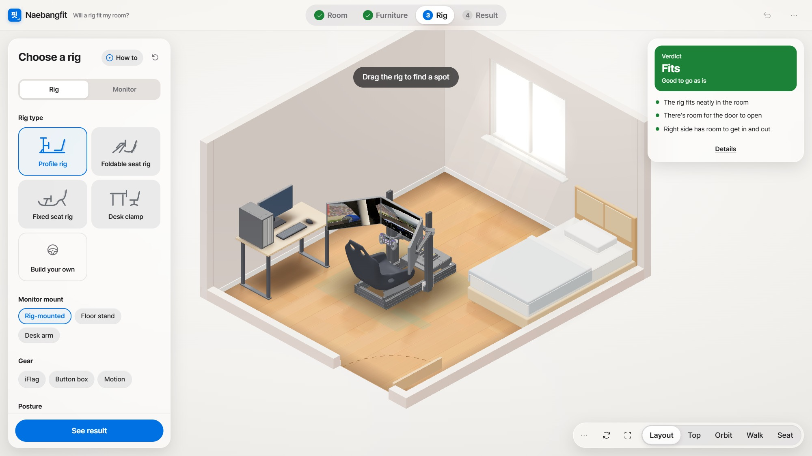
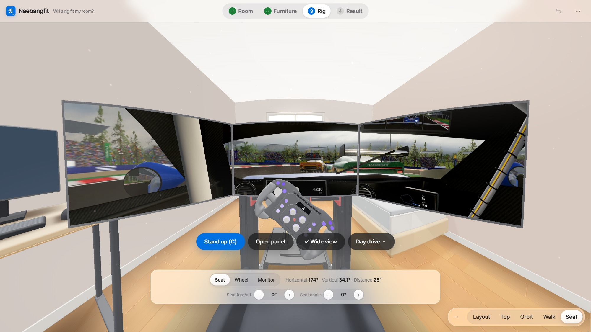
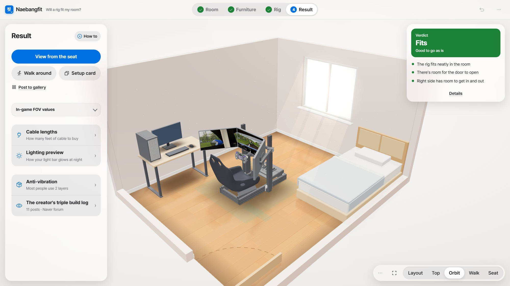
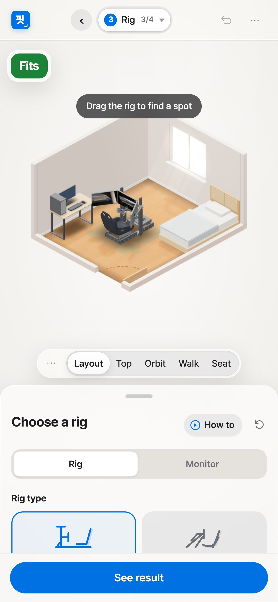

# Naebangfit · 내방핏

[한국어](README.md) · **English**

A free web app that checks whether a sim racing rig fits your room before you buy one.
Enter the room → place a rig in 3D → get a verdict (fits, tight, doesn't fit) → sit in the driver's seat and compare monitor setups.

**[Open the app](https://naebangfit.com/en/)** · [한국어 버전](https://naebangfit.com/) · Version 1.9.1 · [Changelog](CHANGELOG.en.md)

| Place a rig in your room | Driver's view |
|---|---|
|  |  |
| **Result** | **Phone** |
|  |  |

## Features

| Feature | What it does |
|---|---|
| Room | Width, depth, ceiling height, doors and windows (hinged, sliding), L-shaped and other layouts, draw your own on PC |
| Furniture | Beds, desks, chairs, storage, appliances. Snaps to walls and other furniture |
| Rig | Aluminium profile, foldable, fixed and desk-clamp rigs. Compare several. Design your own in the Rig Garage (PC) |
| Monitors | Single, ultrawide, triple (curved too). Rig-mounted, floor stand or monitor arm |
| Verdict | Does it fit, can the door open, room to get in and out, distance to the screens |
| Driver's seat | Seated view, wide view (200°), day and night driving footage with engine sound, FOV values per game |
| Tools | Cable lengths, lighting preview, Showroom (10 rigs to compare, tour, night), Big Screen Hall (six triples, 32" to 65"), setup card (QR), share links |
| Browse | Setup gallery: Naebangfit examples (Showroom, Big Screen Hall, 2 example rooms) and setups shared by others |
| Account (optional) | Google sign-in, My Library (up to 50 setups), post to the gallery |
| What's new | Menu › What's new: what changed in each version |
| Display | PC and phone, light and dark, Korean and English, units cm · mm · in |

Inches: Menu › Settings › Units. The English version opens in inches in US browsers. Rig profiles, game FOV values and part specs stay in mm.

## How to use

- **▶ How to** next to each step's title: a video for that step (landscape on PC, portrait on phones, 1× · 1.5× · 2×)
- Menu (···) › **How to use**: the intro video and every step's video
- Toolbar ··· (bottom right) › **How to**: the view tools and menu

The guide videos are in Korean for now. English versions are on the way.

## Privacy

- Every feature works without signing in
- Sign-in, My Library, share links, the setup gallery and anonymous usage stats: [Privacy Policy](privacy-en.html)
- Anonymous usage stats can be turned off in Menu › Settings

## Repository

| Path | Contents |
|---|---|
| `index.html` | The whole app (one file, Korean) |
| `en/index.html` | English version (same app, English text) |
| `media/` | Driving footage (day and night, per-screen `_L/_C/_R` for PC, `_M` for phones and the room view), driving sound, still frame |
| `media/guide/` | How-to videos (`guide-pc-*` 1920×1080, `guide-mobile-*` 1080×1920), intro video `naebangfit-ad-v3`, start screen loop `naebangfit-bg-loop-*-v3`, `.jpg` posters with the same names. English cuts end in `-en` (used on the English page) |
| `favicon.svg` · `favicon-32.png` · `apple-touch-icon.png` · `icon-*.png` · `site.webmanifest` | Site icons and home-screen info |
| `sitemap.xml` · `robots.txt` | Page list and crawl rules for search engines |
| `privacy.html` · `privacy-en.html` | Privacy Policy (Korean · English) |
| `docs/` | Screenshots for this page, link preview images (`og-ko-2.jpg`, `og-en-2.jpg`) |
| `.github/workflows/keepalive.yml` | Wakes the sign-in server (Supabase) twice a day (also removes anonymous accounts with no posts after 30 days) |

## Copyright

© 2026 헝그리승객 (Hungry Passenger, GitHub [rlacksgur06](https://github.com/rlacksgur06)). All rights reserved: [LICENSE](LICENSE)

- Third-party components and licenses: [THIRD_PARTY_NOTICES.md](THIRD_PARTY_NOTICES.md)
- Where the images, sounds, videos and 3D models come from: [ASSETS.md](ASSETS.md)
