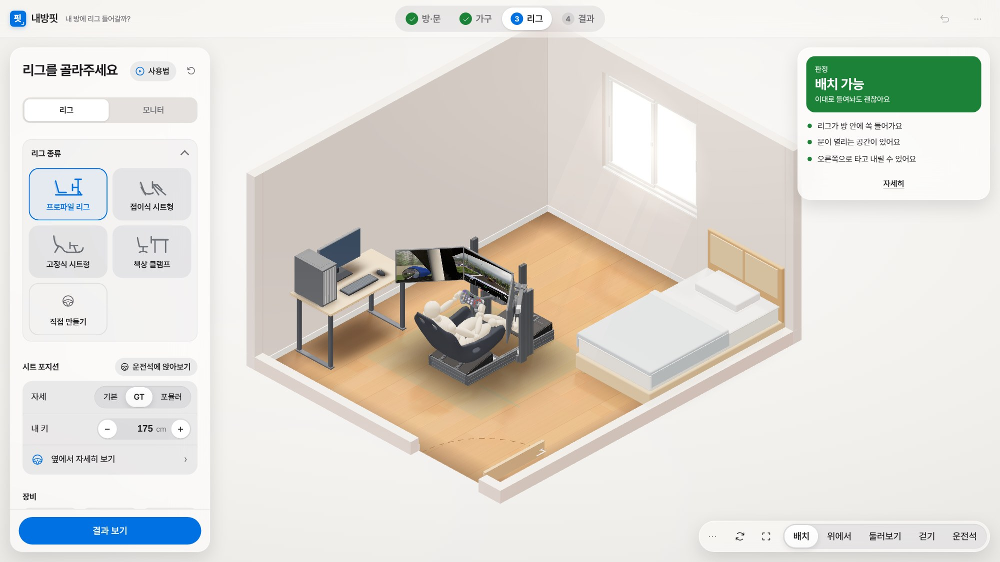
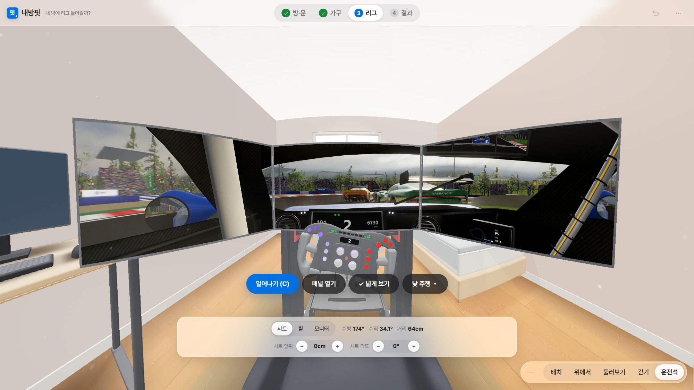
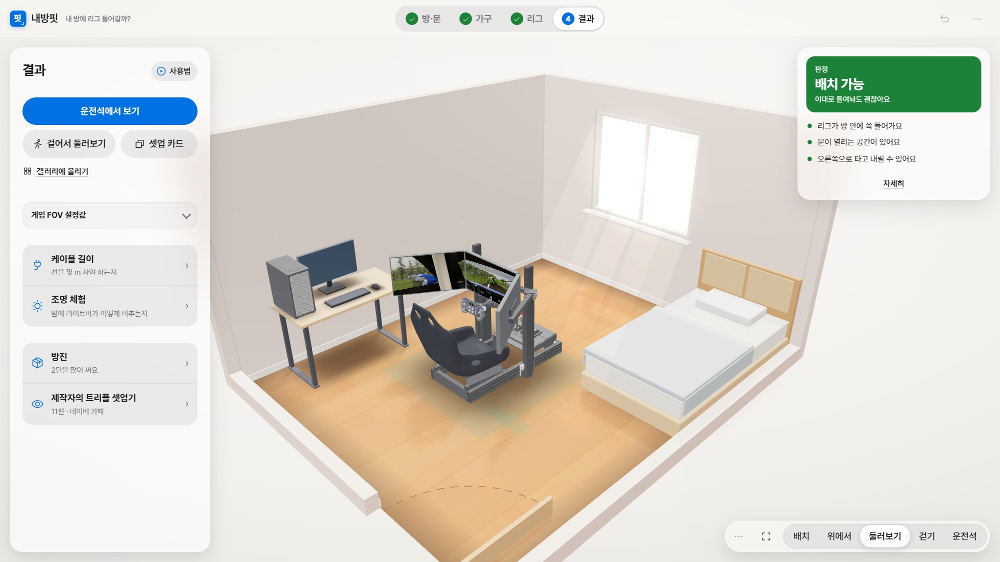
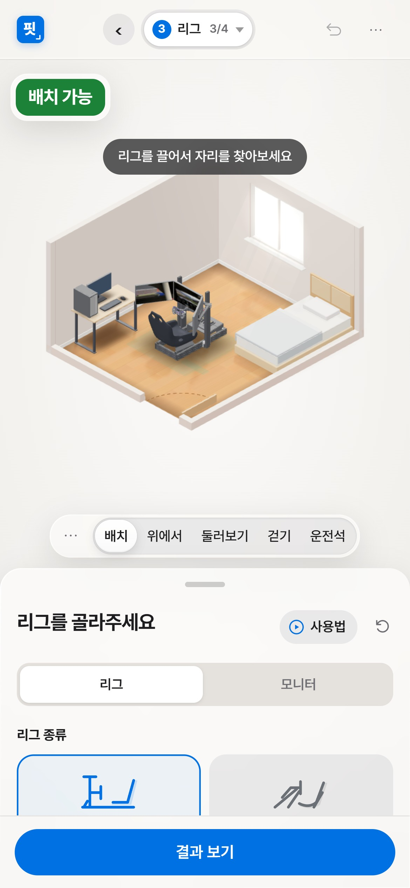

# 내방핏 · Naebangfit

**한국어** · [English](README.en.md)

내 방에 심레이싱 리그가 들어가는지 미리 확인하는 무료 웹 앱.
방 치수 입력 → 리그를 3D로 배치 → 들어감·빠듯함·안 들어감 판정 → 운전석에 앉아 모니터 시야 비교.

**[바로 열기](https://rlacksgur06.github.io/naebangfit/)** · [English version](https://rlacksgur06.github.io/naebangfit/en/) · 버전 1.5.1 · [변경 기록](CHANGELOG.md)

| 방에 리그 놓기 | 운전석에서 보기 |
|---|---|
|  |  |
| **결과** | **휴대폰** |
|  |  |

## 주요 기능

| 기능 | 내용 |
|---|---|
| 방 | 가로·세로·천장 높이, 문·창문(여닫이·미닫이), ㄱ자 등 다른 모양, PC에서 직접 그리기 |
| 가구 | 침대·책상·의자·수납·가전 배치. 벽과 가구에 자석처럼 붙음 |
| 리그 | 프로파일·접이식·고정식·책상 클램프. 여러 대 비교. PC의 리그 개러지에서 직접 설계 |
| 모니터 | 싱글·울트라와이드·트리플(커브 포함). 리그 일체형·바닥 스탠드·모니터암 |
| 판정 | 방 안에 들어가는지, 문이 열리는지, 타고 내릴 공간, 화면까지 거리 |
| 운전석 | 앉은 자리 시야, 넓게 보기(200°), 낮·밤 주행 영상과 엔진 소리, 게임별 FOV 설정값 |
| 도구 | 케이블 길이, 조명 체험, 체험 카페(모니터 10종 비교), 셋업 카드(QR), 공유 링크 |
| 구경 | 셋업 갤러리: 내방핏 예시(체험 카페, 예시 방 3개)와 다른 사람이 올린 셋업 |
| 계정 (선택) | 구글 로그인, 내 라이브러리(셋업 50개까지), 갤러리에 올리기 |
| 화면 | PC·휴대폰, 라이트·다크, 한국어·English, 단위 cm·mm·in |

## 사용법

- 단계마다 제목 옆 **▶ 사용법**: 그 단계 영상 (PC 가로, 휴대폰 세로, 1×·1.5×·2×)
- 메뉴(···) › **사용 안내**: 소개 영상과 단계별 영상 목록
- 오른쪽 아래 도구 막대 ··· › **사용법**: 화면 도구와 메뉴 영상

## 개인정보

- 로그인 없이 모든 기능 사용 가능
- 로그인, 내 라이브러리, 공유 링크, 셋업 갤러리, 익명 사용 통계: [개인정보처리방침](privacy.html)
- 익명 사용 통계는 메뉴 › 설정에서 끄기 가능

## 저장소 구성

| 경로 | 내용 |
|---|---|
| `index.html` | 앱 전체 (한 파일, 한국어) |
| `en/index.html` | 영어 버전 (같은 앱, 글자만 영어) |
| `media/` | 주행 영상(낮·밤, PC 화면별 `_L/_C/_R`, 휴대폰·방 화면용 `_M`), 주행 소리, 정지 화면 |
| `media/guide/` | 사용법 영상(`guide-pc-*` 1920×1080, `guide-mobile-*` 1080×1920), 소개 영상 `naebangfit-ad-v3`, 시작 화면 배경 `naebangfit-bg-loop-*-v3`, 같은 이름의 `.jpg` 포스터 |
| `favicon.svg` · `favicon-32.png` · `apple-touch-icon.png` · `icon-*.png` · `site.webmanifest` | 사이트 아이콘, 홈 화면 추가용 정보 |
| `privacy.html` · `privacy-en.html` | 개인정보처리방침 (한국어 · English) |
| `docs/` | 이 문서의 화면 사진, 링크 미리보기 그림 (`og-ko-2.jpg`, `og-en-2.jpg`) |
| `.github/workflows/keepalive.yml` | 로그인 서버(Supabase)를 하루 두 번 깨워 두는 자동 작업 |

## 저작권

© 2026 헝그리승객 (GitHub [rlacksgur06](https://github.com/rlacksgur06)). 모든 권리 보유: [LICENSE](LICENSE)

- 외부 구성 요소와 라이선스: [THIRD_PARTY_NOTICES.md](THIRD_PARTY_NOTICES.md)
- 그림·소리·영상·3D 모델 출처: [ASSETS.md](ASSETS.md)
